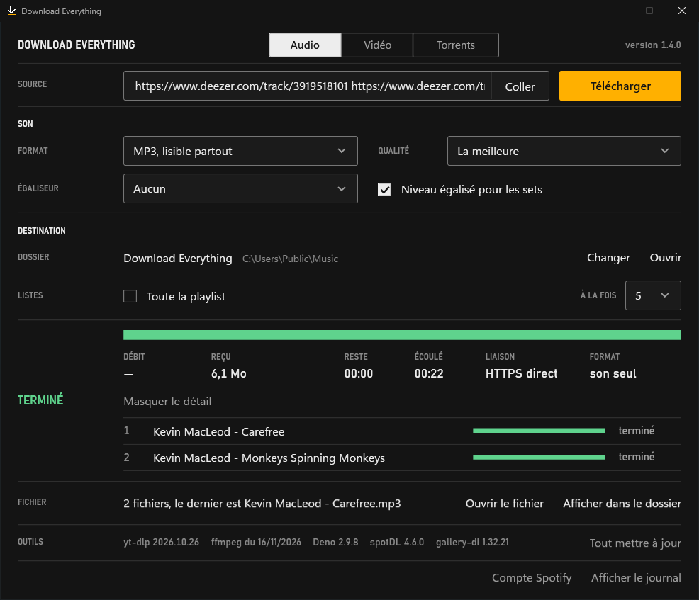

# Download Everything

Un lien, un clic, et le fichier est dans le dossier.



Download Everything télécharge des vidéos, de la musique, des images et des torrents depuis à peu près tout ce qu'on trouve sur Internet. C'est une fenêtre posée sur [yt-dlp](https://github.com/yt-dlp/yt-dlp) et quelques autres outils libres, pour ne plus avoir à taper de ligne de commande.

Sous Windows c'est un seul fichier, sans installation. Sous Debian et Ubuntu, un paquet `.deb`.

## Télécharger

Pour Windows 10 ou 11, prendre [DownloadEverything.exe](https://github.com/Abrupt69/download-everything/releases/latest/download/DownloadEverything.exe) et le lancer. Il n'y a rien d'autre à faire.

Au premier lancement, Windows affiche un écran d'avertissement, parce que le fichier n'est pas signé. Cliquer « Informations complémentaires », puis « Exécuter quand même ». Ça n'arrive qu'une fois.

Pour Debian et Ubuntu, prendre le fichier `.deb` de la [dernière version](../../releases/latest), puis :

```
sudo apt install ./download-everything_1.4.0_amd64.deb
```

L'application apparaît ensuite dans le menu.

## S'en servir

1. Copier l'adresse de ce qu'on veut. Sous Windows, en revenant sur la fenêtre, elle est déjà dans le champ. On peut aussi la glisser dessus.
2. Choisir sa vue avec les trois touches du haut, Audio, Vidéo ou Torrents. L'application s'ouvre sur Audio.
3. Cliquer Télécharger, juste à côté de l'adresse.

Le reste se règle tout seul. Le son sort en MP3 et la vidéo en MP4, deux formats qui se lisent partout. Chaque vue ne montre que ses réglages, et retient les siens quand on passe de l'une à l'autre.

## Ce que ça prend

- Les vidéos et le son de près de 1 800 sites, YouTube en tête.
- Les liens Spotify, Deezer et Apple Music, que ce soit un morceau, un album ou une playlist. L'application lit la liste des titres, puis va chercher chaque morceau sur YouTube. Rien n'est pris sur ces services eux-mêmes.
- Les images et les galeries d'images.
- Les torrents, par lien magnet ou fichier `.torrent`. Ils ont leur propre vue, avec les sources, les pairs et le débit.
- Les fichiers ordinaires, un PDF ou une archive par exemple.

Plusieurs liens collés d'un coup partent ensemble.

## Bon à savoir

Une playlist ou un album se télécharge à plusieurs morceaux à la fois, cinq au plus, avec une ligne et une barre pour chacun. Au-delà de cinq, YouTube refuse la connexion, le réglage ne va donc pas plus haut. Ce qui est déjà dans le dossier n'est pas repris. À la fin, un bouton relance seulement ce qui a raté.

Chaque morceau reçoit sa jaquette, son titre, son artiste et son année, et s'appelle « Artiste - Titre.mp3 ».

Le son vient de YouTube, autour de 128 à 160 kb/s. Choisir du FLAC ou du WAV grossit le fichier sans rien ajouter à ce qu'on entend. Les autres formats (M4A, AAC, Opus, Vorbis, FLAC, WAV, AIFF, ALAC) sont là pour qui en a besoin, tout comme un égaliseur à cinq réglages tout faits.

Pour qui mixe, l'interrupteur « Niveau égalisé pour les sets » ramène chaque morceau vers −9 LUFS, le niveau des morceaux de club, pour les enchaîner sans retoucher le gain à chacun. Le son n'est pas réencodé et sa dynamique ne change pas. Dans un MP3, c'est le réglage de volume des trames qui est déplacé, comme le fait MP3Gain. Un morceau trop calme pour être monté sans saturer est laissé tel quel, et le journal le dit. L'interrupteur marche avec le MP3, le FLAC, le WAV, l'AIFF et l'ALAC.

Il arrive que YouTube donne un autre morceau de la même durée que celui demandé. Quand le titre trouvé ne ressemble pas au titre attendu, le morceau est marqué « à vérifier » et noté dans un fichier texte à côté. À l'oreille de trancher.

L'application se tient à jour. Elle signale ses nouvelles versions, et un bouton met à jour les outils qu'elle embarque.

## Quand ça coince

### YouTube refuse de répondre

Après beaucoup de téléchargements d'affilée, YouTube peut bouder une connexion, de quelques minutes à quelques heures. La liste se met alors en pause, réessaie un seul morceau de temps en temps, et repart au ralenti dès que ça répond. Il n'y a rien à faire et rien n'est perdu. Si le refus dure plus de quatre heures, elle s'arrête et propose de reprendre plus tard.

L'application ne cherche pas à contourner ce refus, elle attend.

### Une playlist Spotify s'arrête à 100 titres

Spotify ne montre que les 100 premiers titres au public.

Pour vos propres playlists, « Compte Spotify » en bas de la fenêtre permet de vous connecter et de lire la liste entière en quelques secondes. Il faut pour cela créer une application sur le [tableau de bord des développeurs Spotify](https://developer.spotify.com/dashboard), ce que Spotify réserve aux comptes Premium, lui donner l'adresse de retour `http://127.0.0.1:8765/callback`, puis coller son identifiant dans la fenêtre. Le jeton de connexion reste sur votre poste.

Pour les playlists des autres, la suite est lue en arrière-plan pendant que les 100 premiers titres se téléchargent. C'est plus lent.

### Windows affiche une alerte de pare-feu au premier torrent

C'est normal. Un outil de torrent écoute le réseau pour que d'autres puissent le joindre, et Windows le signale. Refuser n'empêche pas de télécharger.

### Un torrent reste sur « recherche de sources »

Plus personne ne le partage. Il n'y a rien à faire de plus.

## Ce que ça ne fait pas

Les plateformes de films et de séries par abonnement sont protégées contre la copie. L'application ne les prend pas et ne les prendra pas.

Tidal, Qobuz et Amazon Music refusent qu'un programme lise leurs listes. L'application le dit et s'arrête là.

Ce qui demande d'être connecté ne passe pas non plus, comme les comptes privés, les contenus réservés aux abonnés ou Reddit. Les publications publiques d'Instagram, de TikTok et de X passent le plus souvent.

## Sous Linux

Le paquet amène avec lui ffmpeg, aria2 et les bibliothèques graphiques. À la première ouverture, l'application télécharge yt-dlp, Deno et gallery-dl depuis leurs dépôts officiels. Il faut donc être connecté à Internet ce jour-là.

Il manque encore quelques petites choses par rapport à Windows. Pas de glisser-déposer, une fenêtre de taille fixe, pas de mouvements quand une zone s'ouvre, et la suite des longues playlists Spotify des autres n'est pas lue. Une nouvelle version est signalée, mais elle s'installe en reprenant le paquet.

La version Linux a été essayée sur Debian 13 et Ubuntu 24.04 dans des machines de test, pas encore sur un vrai bureau. Les retours sont les bienvenus.

## Ce qu'il y a dedans

L'application s'appuie sur [yt-dlp](https://github.com/yt-dlp/yt-dlp), [FFmpeg](https://ffmpeg.org), [Deno](https://github.com/denoland/deno), [spotDL](https://github.com/spotDL/spotify-downloader), [gallery-dl](https://codeberg.org/mikf/gallery-dl) et [aria2](https://github.com/aria2/aria2). Chacun vient de son dépôt officiel, et son empreinte est contrôlée avant usage. Chacun garde sa licence, détaillée dans [NOTICES.md](NOTICES.md).

L'application n'envoie rien nulle part. À l'ouverture, elle regarde la page des versions de ce dépôt pour savoir s'il en existe une nouvelle, et c'est tout.

L'empreinte SHA-256 de chaque fichier publié est donnée dans les notes de sa version, pour qui veut la vérifier.

## Usage responsable

Vous êtes responsable de ce que vous téléchargez. N'utilisez cet outil que pour des contenus que vous avez le droit de copier, les vôtres, ceux du domaine public ou sous licence libre, ou ceux dont la copie privée est permise par la loi de votre pays.

## Compiler soi-même

Il faut le SDK .NET 10 et PowerShell 7.

```powershell
# 1. Rassembler les outils à embarquer, pris sur leurs dépôts officiels
pwsh -File preparer-charge.ps1

# 2. Publier l'exécutable unique
dotnet publish YtDlpInterface.csproj -c Release -o publication
```

L'exécutable se trouve ensuite dans `publication\DownloadEverything.exe`.

Le paquet Linux demande Docker en plus. La compilation se fait sur place, l'emballage dans un conteneur Debian jetable.

```powershell
pwsh -File linux\construire-deb.ps1
```

Le paquet se trouve ensuite dans `linux\publication\`.

## Le code

L'application est écrite en C#, avec WPF pour Windows et Avalonia pour Linux. Le moteur et le code des fenêtres sont communs aux deux versions, seuls les dessins diffèrent (`.xaml` d'un côté, `.axaml` de l'autre). Les passages propres à l'une ou à l'autre sont entre `#if PORTABLE` et `#endif`. Les commentaires sont en français.

| Fichier | Rôle |
|---|---|
| `FenetrePrincipale.xaml` et `.xaml.cs` | la fenêtre et son déroulé |
| `YtDlp.cs` | arguments et lancement de yt-dlp |
| `PageSpotify.cs`, `CompteSpotify.cs`, `SpotDl.cs` | lecture des liens Spotify |
| `AutresCatalogues.cs` | lecture des liens Deezer et Apple Music |
| `GalleryDl.cs` | images et galeries |
| `FichierDirect.cs` | fichier ordinaire pris tel quel |
| `Aria2.cs`, `VueTorrents.xaml` et `.xaml.cs` | torrents et leur vue |
| `NiveauSonore.cs` | niveau égalisé pour les sets, sans réencodage |
| `VersionDeLApplication.cs` | avis de nouvelle version et remplacement de l'exécutable |
| `MiseAJourDesOutils.cs` | mise à jour des outils embarqués |
| `ChargeEmbarquee.cs`, `Charge/` | transport des outils dans l'exécutable |
| `ArbreDeProcessus.cs` | arrêt propre des téléchargements |
| `linux/` | la version Linux, son dessin et son paquet `.deb` |

## Licence

Le code de Download Everything est sous licence MIT, voir [LICENSE](LICENSE).
